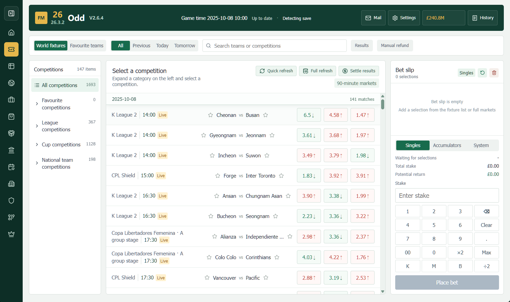

<div align="center">


[English](README.md) &nbsp; · &nbsp; [简体中文](README.zh-CN.md) &nbsp; · &nbsp; [한국어](README.ko-KR.md)

# Football Manager ODD

> **Current name: FMSDD** (**S = Stock**). Existing program folders, saves, fonts, compatibility identifiers and the `fmodd.com` domain keep their legacy names for compatibility; **FMSDD is the product name**.

**Bring club management, player development and match play into your FM career.**

A Windows companion for Football Manager, built around clubs, players and the stories you create.

<a href="https://github.com/ShineMiyo/FMSDD/releases"></a>


**[Download for Windows](https://fmodd.com/download)** &nbsp; · &nbsp; **[Releases](https://github.com/ShineMiyo/FMSDD/releases)** &nbsp; · &nbsp; **[Report an issue](https://github.com/ShineMiyo/FMSDD/issues)**

</div>

---

## More to build, more to remember

FMSDD is a local Windows companion built around your Football Manager career. Manage clubs you own, arrange player training and team activities, handle funds and personnel between matches, and keep a record of player development, memorable matches and relationships.

Features follow your current save and game date. Match play uses an ODD virtual wallet. Some club, personnel and training operations modify native FM data after version checks pass. Availability depends on the exact game build and distribution platform.

## Six ways to shape your football world

<table>
<tr>
<td width="50%" valign="top">
<h3>01 · Club management</h3>
<p>Find clubs in the world directory, acquire them and manage your group. Review finances, facilities and personnel across the clubs you own.</p>
</td>
<td width="50%" valign="top">
<h3>02 · Player development</h3>
<p>Arrange training equipment, position training, coach development and youth plans. Training records help you follow progress over time.</p>
</td>
</tr>
<tr>
<td valign="top">
<h3>03 · Match play</h3>
<p>Explore fixtures, odds, live markets, league tables and title markets. An ODD virtual wallet, bet history and settlement bring matchdays into your management routine.</p>
</td>
<td valign="top">
<h3>04 · Team life</h3>
<p>Use the activity centre, canteen and hospital for recreation, counselling, nutrition and medical tasks. Track player and staff conditions, interactions and relationships.</p>
</td>
</tr>
<tr>
<td valign="top">
<h3>05 · Player departures</h3>
<p>Find a new club for a player and choose from cards showing simulated offers. Proceeds go into the selling club’s transfer budget.</p>
</td>
<td valign="top">
<h3>06 · Career memories</h3>
<p>Follow people in the Hall of Fame, record attribute changes, match moments, injuries and transfers, and explore your career through relationships and timelines.</p>
</td>
</tr>
</table>

## A look inside FMSDD

### Fixtures and odds



<sub>This screenshot is from V2.6.4 and illustrates the interface style. The current application determines the available layout and features.</sub>

## V2.9.6cBeta · Outside encounters, family workspace v3 and adult gate

- **2.9.6c — money, action points, measurements and the Instant Birth Pill** — send cash to a person; the gain depends on her personality, values, bond, reputation and previous gifts. Buy missing action points at 50,000,000 per point. Measurement ranges are now asymmetric per-UID fuzz ranges, so the midpoint no longer reveals the exact value. The children shop adds the 1,000,000,000 Instant Birth Pill, usable from the backpack on a pregnant NPC for an immediate birth. Travel asset level, traveller profession, multi-folder portrait sources, obedience and conception chances from 2.9.6a remain included.

- The People workspace has a new **Go out** tab: all nine SDD countries and 68 cities, with 388 places. Going out or trying a place costs one action point; no plane or car is required.
- Real FM women's players are preferred, picked from clubs in the destination country. About 30% of encounters use a fictional traveller; if the save has no women's football or no eligible player, a fictional traveller is created and marked `source="encounter"` — never disguised as an FM player.
- Encounter chance starts at 45%; asset level adds 2% per level, up to 80%. Cars, planes and vehicle tiers do not add a bonus.
- Chat, ask for contact, or say goodbye on the encounter card. A traveller stays hidden from People until contact is saved; existing chat, gifts, dates and intimacy continue in the normal relationship system.
- The Family tab is now **summary cards → horizontal parent/child selector → main workspace → persistent right rail**. The rail shows academy progress, CA/PA, FM UID, club, family and recent records.
- Academy cards resolve the club name before showing the FM UID; a numeric UID is never used as the club name.
- The adult-content setting now asks for 18+ confirmation. Turning it off hides intimate entries, adult items and adult-only encounter options; the server still rejects those requests.
- Three item-linked intimate actions (toy, blindfold, dice) and an action-time protection choice consume the matching Backpack item and update the pregnancy window on the server.
- The 2.9.5 pregnancy, child growth, native academy write-back and managed-club academy fixes remain in place.

## V2.9.3Beta · Safer batch buying, claimable asset cars and readable records

- The city bulk-buy dialog now shows available funds and the exact shortfall. The dialog shows the shortfall but leaves the final funds check to the backend, so a stale client balance cannot block a legitimate purchase; insufficient funds now return a clear reason, and failed commits roll back and refund.
- The garage batch footer stays inside the dialog at shorter window heights, with the vehicle list as the only scroll area.
- The storage garage capacity is now 10,000, with automatic migration for older saves and updated copy in all interface languages.
- Asset levels 2–6 now award five classic cars. Unlocked rewards are claimed explicitly from the season-pass cards: storage first, then any other garage with free space, and a clear failure when every garage is full.
- The asset portfolio groups properties by city and district, with per-group counts and values plus per-group and global expand/collapse; large portfolios start collapsed.
- Bulk purchase now prices through `buy-batch/prepare` and commits once; city-profile and save deep copies were removed, cutting a 123-plot Guangzhou purchase from 45.1s to 0.84s.
- A new Family tab lets you name children, buy expensive irreversible growth elixirs and, at 15, place them in your club's youth intake or recommend them to a bigger owned club. Placement reuses the native youth-generation plan and reflects its status back on the child card.
- Spouses can now date even if their social stage is stale; the date picker and backend both allow committed relationships.
- Asset gifts group properties by city and district with filters and collapse, while vehicles show manufacturer, class, rarity, image and current garage with their own filters.
- Intimacy records are grouped by month under an Intimacy history sub-tab, and each record expands to its cost, intimacy change and conception chance.
- Conception chance rises with intimacy. A conceived relationship shows "possible pregnancy" with days remaining and raises the pregnancy event after 30 days; an unconceived night shows nothing.
- The profile ledger no longer exposes internal keys such as `asset_level` or `asset-level:7`; it shows readable level and vehicle rewards. Reputation is now an allocatable gold-bordered attribute costing **5 points per point**, with all FM labels and manager-reputation reads removed. The profile editor uses a clearer identity/attribute split, gold reputation card, per-point cost tag and a sticky save bar; legacy saves receive a reputation migration entry to preserve their available points.

## V2.9.2Beta · Gacha layout, batch garages and a season-pass asset board

- The mystery-garage multiplier now sits beside each pool title, and single/ten-pull buttons are back. The multiplier scales both buttons (single ×N, ten ×10N), with 1–1000 pulls priced as full ten-packs plus singles; draw buttons refresh as soon as a storage or batch dialog frees space.
- The garage batch manager keeps its list scrollable while the value summary and move/sell footer stay visible. Selecting a car no longer rebuilds the list, and storage selection preserves its scroll position.
- Every garage, storage view and batch manager can sell duplicate cars in one click. For each model the highest-value copy stays; the rest are sold in one server transaction with rollback.
- Asset milestones are now a horizontal season-pass board: current-level emblem, progress, level cards with car artwork, locked/claimed/pending states, drag/wheel/arrow/button or touch scrolling, and non-selectable text.

## V2.9.1Beta · Relationship lines, batch operations and garage growth

- Relationships now branch by the player/NPC gender pair after close friend: romance (ambiguous → couple → spouse) or a friendship line (partner → kindred → best friend / brother → sworn brother). The first step locks the chosen line, and the qualitative relationship tone (stranger, distant, polite, familiar, close, in sync, bonded) is reported separately from the level.
- Asset milestones moved from the interaction overview to an "Assets Lv.N" button beside the player name; the milestone timeline opens in a dialog and scrolls horizontally with the mouse wheel.
- The property map can buy every unowned plot of a chosen type in the current city in one transaction, with a live count and total; the batch is charged once and rolls back on failure.
- Each garage now has a batch manager with select-all and manufacturer/class/rarity filters, bulk transfer and bulk sale. The showroom can buy the current filtered set while still excluding display-only cars, and each mystery-garage pool has a ×1/×2/×5/×10/×100 multiplier.
- City generation can produce 64/96/128-space premium garages in outer districts, and purchased garage assets now sort above property-provided parking in the garage directory.

## V2.9.0Beta · Relationship consequences, EQ and asset milestones

- Intimacy is now signed from -100 to +100 with distinct negative bands. Sustained or severe negativity can trigger a relationship crisis; the player may attempt a repair based on EQ, trust and remaining intimacy, or accept separation.
- "Stay close" can now lead to conception. A pregnancy decision appears after 30 days; keeping the child creates a persistent family record, while ending the pregnancy sharply reduces intimacy and trust.
- Secret relationships accumulate exposure risk from "Stay close" and "Getaway". Exposure penalises the public partner and forces a choice between ending the secret bond or leaving the public relationship.
- A new EQ profile attribute shapes overall social calibration and crisis repair, while charm amplifies affection, appearance amplifies attraction and ability amplifies respect across chat, gifts, dates and intimate actions. The same choice can now produce materially different results for different player profiles; social contribution is capped at 100 points so uncapped allocation cannot break balance.
- The overview adds an asset-level timeline based on owned property and vehicle value. Levels award permanent profile points and special vehicles; rewards are idempotent, and a full garage leaves the vehicle pending for automatic retry.
- The intimacy explanatory footer is now single-column, removing the confusing left/right split.
- The map catalogue expands from 27 to 68 cities across 9 countries, adding 41 Chinese and overseas cities with terrain masks that avoid water, coastline, green space and parks.
- Version metadata, the window title and desktop host are now **V2.9.0Beta** / `2.9.0.0`; the development identifier is `64-dev`.

## V2.8.9eBeta · Rebuilt action results and committed-relationship intimacy

- Every interaction result — chat, gift, date, asset gift, relationship change and intimate moment — now uses a self-contained single-column result card. The old two-column shell with a blank right side, oversized buttons and loose spacing is gone; speaker, outcome, dialogue, AP/chance/intimacy metrics, rewards and confirmation now follow one readable hierarchy.
- Intimacy is a new committed-relationship resource (0–100). It unlocks only for partners, secret lovers and spouses, starts at 18/15/28 for those stages, and is earned through chats, gifts, dates and asset gifts.
- A conditional **Intimate moments** tab appears to the right of Relationship progress only when the bond qualifies. Six actions — embrace, kiss, cuddle, stay close, private getaway and talk about the future — carry icons, per-action accent colours, AP cost and intimacy cost; stage rules gate getaways and future planning.
- Save migration moves to schema 6, preserving existing people and points while adding intimacy fields. Breakup and divorce reset intimacy, and the future-family flag is retained for the later children system.
- Chat, gift, date, asset-gift and result copy gains intimate-relationship variants across all 11 interface languages. Version metadata, the window title and desktop host are now **V2.8.9eBeta** / `2.8.9.5`; the development identifier is `63-dev`.

## V2.8.9dBeta · Conversation workspace, readable actions and live manager reputation

- Gift and date actions now use scoped interaction theme variables, so primary and disabled buttons remain visible without hovering. Gift categories and date activities carry distinct accent colours, while each person header keeps its relationship badges on a tinted surface.
- Date cards show AP only once, in the upper-right lightning badge. The selected-person header, relationship stage badges and confirmation area now have stronger contrast and clearer hierarchy.
- Chat is rebuilt as a dedicated messaging workspace with a conversation header, date-separated history, player/contact bubbles, topic selector, multiline composer, AP cost and template-reply disclosure. Submitted text is persisted in the timeline and sent back with the action result; older chat rows without stored text still receive a topic-aware fallback reply.
- Interaction gains are grouped into a labelled reward strip beneath each exchange. The selected chat topic survives a reply refresh, and the dialog closes safely when the save scope changes.
- The player name uses the interface font. Reputation is no longer an allocatable profile attribute: appearance, ability and charisma remain freely allocatable, while manager reputation is read live from the current FM manager and shown as a read-only 0–100 projection with the raw value, domestic reputation and world reputation when the layout exposes them. Legacy reputation values remain in saves for compatibility and no longer consume allocation points.
- Chat and manager-reputation copy covers all 11 interface languages. Version metadata, the window title and desktop host are now **V2.8.9dBeta** / `2.8.9.4`; the development identifier is `62-dev`.

## V2.8.9cBeta · Relationship rail polish, resident cards and visual pickers

- The People relationship rail now uses a 310–350px column so delete actions and relationship badges no longer crowd each other. The exclusive-relationship chip is removed from the row header while exclusivity rules remain unchanged, and affection uses five colour bands from distant to devoted.
- The overview relationship network now uses the same portrait resolver as dossiers, including the portrait toggle and UID offset. Missing or unreadable images still fall back to initials.
- **Assets → Residence** now presents up to two selectable residence cards per row. Select a card, then confirm Move in; each card shows the address, area, level, capacity, market value and every resident with portrait, name, club and relationship badge. The server residence projection now includes `occupants` so the client no longer infers residents from relationship rows.
- Gift giving and dates no longer use long dropdowns. Both open large visual pickers: gifts are grouped by name with stock counts and preference markers, while date cards show icons, AP cost, preference and the Friend-stage gate. Confirmation remains the only point that spends AP or inventory.
- Empty date catalogues no longer produce infinite cost summaries, and new copy covers all 11 interface languages. Version metadata, the window title and desktop host are now **V2.8.9cBeta** / `2.8.9.3`; the development identifier is `61-dev`.

## V2.8.9bBeta · Contact removal, gift boutique, relationship gates and action ledger

- Relationship rows now provide a delete action. The confirmation explains that the relationship, residence assignment and that person's timeline will be cleared, while permanently gifted properties, businesses and vehicles are retained.
- **Items → Gifts** is a new secondary page with eight curated categories: books, fashion, technology, food, sport, music, art and luxury. Gift purchases use the server catalogue, support quantities and balance checks, and arrive in the Backpack for giving from People.
- The People workspace is split further: People contains dossier, interaction and owned-assets views, while Interaction contains its home and relationship-progress views. Chat, gifts and dates stay on the interaction home; relationship actions and breakup/divorce controls move into the progress view and a more-actions drawer.
- Relationship progress now lists every next-stage requirement. Friend needs familiarity 25, affection 30 and trust 20; close friend needs 50/55/45 plus respect 35; confidant needs 75/75/70 plus respect 60. Romance gates also show attraction, affection, trust, social stage and exclusivity requirements.
- Owned assets are grouped into properties and vehicles, with gift date, value, total value and a permanent-transfer badge. The action-point card gains a ledger for chats, gifts, dates, relationship actions, weekly recovery and CDK grants.
- Overview adds a relationship network grouped by spouse, partner, secret lover, confidant, close friend and friend. Chat, gift and date actions use a three-column workspace, and the long-standing blank area on the right has been removed while all visible text remains at least 13px.
- All new copy covers the 11 interface languages. Version metadata, the window title and desktop host are now **V2.8.9bBeta** / `2.8.9.2`; the development identifier is `60-dev`.

## V2.8.8aBeta · Structured People workspace, point-built profiles and richer NPCs

- **Life → People** is now split into Overview, People, Search, Assets and Timeline. People contains separate dossier and interaction views; Assets separates residence moves from permanent asset gifts, keeping the profile, search results and action panels out of one long mixed page.
- New profiles allocate 200 base points across appearance, ability, charisma and reputation, while age, height, weight and biography remain saved identity fields. Reducing an allocation after completion requires a paid reset; points earned from purchased properties, businesses and vehicles remain in a permanent ledger for later allocation.
- Cached players now include height, weight, personality, values, favourite topics, activities and gifts, plus explicit dislikes. Adult female players also receive bust, waist and hip measurements. FM top-level height and weight are imported during caching and normalization.
- Chat, gift, date and relationship outcomes use three deterministic reply variants in every supported interface language. Variant selection considers the topic, NPC personality and values, social stage and romance stage rather than showing one universal reply.
- Settings now includes **Show player portraits**. When enabled, portraits use the configured FM facepack and fall back to names or initials; when disabled, text avatars are always used. Residence and gift asset names follow the saved interface locale.
- Version metadata, the window title and the desktop-host assembly are now **V2.8.8aBeta** / `2.8.8.1`; the development build identifier is `55-dev`.

## V2.8.7bBeta · Storage filters, stable archives and revised Collector gold

- The storage garage now uses a compact class badge that no longer obscures vehicle artwork. Its filter bar adds manufacturer, class, rarity and an aggregated Legendary & special category; search, select-all, moves and sales follow the active filter.
- Background status polling no longer rebuilds life pages while a collection, storage or draw-history dialog is open, fixing the periodic flicker and scroll jumps in Collector Vault records.
- The latest-delivery header is reorganised into aligned value, cost and net-return cards, with the gold summary and helper text kept in their own area for faster ten-draw scanning.
- Collector Vault gold is now `S2 + Legendary / Forza Edition`, or any class `+ Donut Edition`. Natural draws, soft/hard pity, historical recomputation and frontend crowns continue to share one rule.
- Version metadata, the window title and the desktop-host assembly are now **V2.8.7bBeta** / `2.8.7.2`; the development build identifier is `53-dev`.

## V2.8.7aBeta · Life-data preload, pool catalogues and clearer vehicle classes

- Connected saves now prefetch the life document and full vehicle catalogue after the final save state is ready. A start/finish toast explains the wait; calls are deduplicated by save scope and game date, and a short failure cooldown prevents noisy retries. The first mystery-garage draw no longer pays the normal life-data first-load penalty.
- Every mystery-garage pool now has a **Pool catalogue** button beside its title. The secondary archive lists only that pool's drawable cars and supports search, class/rarity filters, save-level collection status and exact gold-eligible markings.
- D/C/B/A/S1/S2 badges are now larger (minimum 16px) with six distinct colour treatments; S2 adds a restrained animated sheen. The same badge component is used in the showroom, garage, storage, collection, draw results and pool catalogue.
- Settings now includes **Confirm before each draw**. It is enabled by default; disabling it skips only the per-draw confirmation dialog, while every draw remains server-authoritative.
- Version metadata, the window title and the desktop host are now **V2.8.7aBeta** / `2.8.7.1`; the development build identifier is `52-dev`.

## V2.8.7Beta · Collection dialog, incremental draws and Donut gold fix

- Fixed the collection dialog opening grey and refusing to close from either the garage or the mystery garage. It now shares the full life theme variables and closes via the header button, backdrop click or Escape.
- Mystery-garage draws now use an incremental response: only the new vehicles, garage/storage summary, collection and pool counters are returned instead of the entire life document. Image prewarming uses two workers and pauses during a draw, while the draw button reports its own progress instead of the general life-data message.
- Collector Vault gold is now `S2 + Forza Edition` **or any class + Donut Edition**. The only Donut car in the pool, the S1 Ford Supervan 3, now receives the gold crown, resets guarantee progress and counts as gold. Natural gold rates are Street `0.6657%`, Performance `0.3620%` and Collector `0.6617%`; long-term rates including pity are `2.0244% / 1.8568% / 1.6218%`, or about `49.4 / 53.9 / 61.7` pulls per gold.
- The draw status, OR rule, hard-pity and soft-pity copy are updated in all eleven interface languages.
- Version metadata, the window title and the desktop-host assembly are now **V2.8.7Beta** / `2.8.7.0`.

## V2.8.6Beta · Vehicle collection, rarity-led pricing and transparent draws

- Mystery-garage gold now requires the **intersection of the pool's top class and top rarity**: Street `A + Epic`, Performance `S1 + Legendary`, and Collector `S2 + Forza/Donut`. A top-class car with a lower rarity no longer resets the guarantee.
- Street Discovery is now `500,000 / 4,000,000` for single/ten draws, and Collector Vault is `20,000,000 / 150,000,000`. The interface publishes both the base gold rate and the guarantee-adjusted long-run expectation.
- Pool archives now show tracked draws, total spend, gold count, total vehicle value, observed and expected gold rates, plus a seven-step unlucky-to-lucky rating. Each new record shows its allocated cost and vehicle value. Existing history is retained, while cumulative tracking starts with the next draw after upgrade and states its starting draw explicitly.
- The Garage no longer keeps the collection strip on its main page. A **Collection** button beside the Garage title opens a modern full archive with overview, all-model, manufacturer and legendary/special tabs, plus search and manufacturer, class, rarity and ownership filters.
- The collection now belongs to the save's life document (schema 9). A save without one is rebuilt from the vehicles already in its garages; the former account-level `life_collection.json` is no longer read, so other saves cannot lend or lose models.
- Vehicle images now use persistent Cache Storage plus one-year immutable HTTP caching for the local car assets. The desktop service reuses a stable loopback port so those caches survive normal application restarts; lazy loading and idle prewarming keep the first screen responsive.
- A fixed **Storage garage** provides 100 spaces. It can be opened beside the Garage title and supports select-all, batch moves to a chosen garage, and batch sales with a 3% fee and a single server-side bank credit.
- Vehicle prices now follow a **rarity-first, class-second** model; the former catalogue price only orders cars within the same rarity and class. Legendary cars start at 5 million, while Forza and Donut special editions start at 15 million, so no legendary hypercar remains available for tens of thousands.
- The showroom still presents the full catalogue, but 96 legendary cars, 9 Forza editions and the Donut edition (106 models in total) are marked **showcase only**. The server rejects purchase requests that bypass this client-side lock.
- Mystery-garage single and ten-draw prices are now Street `£200,000 / £1,800,000`, Performance `£5,000,000 / £45,000,000` and Collector `£25,000,000 / £200,000,000`. Base class and rarity odds are published in the interface alongside soft-pity rules, and each tier card has a top-right history button for the complete retained draw record.
- Performance Hunt now includes class C with base odds of C/B/A/S1 `24/38/33/5%`; Legendary is `2.5%`. Collector base rates are A `60%`, S1 `32%`, S2 `8%`; Rare `12%`, Epic `82.25%`, Legendary `5%`, Forza Edition `0.25%` and Donut Edition `0.5%`. The highest class is therefore the rarest class in each pool without hiding the rules.
- Each delivery shows the combined current market value of every car drawn plus the draw cost, net result and ROI. The server computes `total_value` from the per-car valuations used by the existing market model.
- Natural gold odds were raised while keeping the published class and rarity marginals: Street base `0.666%` (long-run `2.024%`), Performance `0.362%` (`1.857%`) and Collector `0.162%` (`1.336%`). Duplicate labels use the number of that model already in this save's garages before the draw, not a lifetime pull count.
- The Mystery Garage has its own **Collection** entry. Its odds header no longer repeats class/rarity labels beside the title, and the delivery-garage toolbar uses a single aligned row of equal-height cards.
- Collection and odds copy is available in all eleven interface locales. Version metadata, the window title and the desktop host are now **V2.8.6Beta** / `2.8.6.0`.

## V2.8.5Beta · Life shortcut and a grouped Items menu

- The home screen now exposes **Life** directly and no longer carries a separate Inventory shortcut. The existing Items-style shortcut continues to open Shop and is labelled **Items**.
- The sidebar groups **Shop** and **Backpack** under a new first-level **Items** menu. Selecting Items expands the group and opens Shop; entering either child page keeps the group highlighted.
- Page keys, APIs, local storage and save compatibility are unchanged. Font folders and the original `FMSDD` compatibility identifiers continue to work as before.
- All eleven interface locales use the updated Items and Backpack wording.
- Version metadata, the window title and the desktop host are now **V2.8.5Beta** / `2.8.5.0`.

## V2.8.4Beta · Leases, construction and a 27-city life map

- Residential property can be kept for owner use or leased, and furnishing upgrades raise its rental income.
- Commercial and industrial plots can be leased or operated. Operators choose from five facilities or industries, set staffing between the property's minimum and maximum, and pay payroll from gross income. The dashboard reports monthly gross revenue, monthly payroll and monthly net income, while income accrues daily. Upgrades add 20% rent or 18% operating income per level; there are no supply chains.
- Standalone garages can stay available for personal parking or be leased for income. A garage with vehicles must be emptied before leasing, and a leased garage contributes no usable parking spaces.
- The page is now **My assets** and filters by residential, commercial, industrial or garage assets, ownership tenure and construction status.
- A plot can be bought or leased for 30, 90, 180 or 365 days. Leases prepay the full term plus a 1.5-month deposit, can be renewed or released, and never count as owned net worth; leased assets cannot be sold.
- Upgrades and new business setups require confirmation with their cost and construction days. Income pauses until the game date completes the project, and changing a commercial or industrial business requires a new setup.
- Income is closed into segments whenever the mode, business, staffing or level changes, so a later decision cannot rewrite earlier earnings. Existing life saves migrate to schema 5; property district IDs, vehicles, garages and historical income are retained.
- The life map now covers **27 cities in four countries**. China adds Hong Kong, Macau, Shantou, Xiamen, Quanzhou, Fuzhou, Ningbo, Suzhou, Qingdao, Jinan, Tianjin, Xi'an, Chongqing, Guiyang, Kunming and Nanning; the United Kingdom, France and Germany add London, Paris and Berlin. Country and city selectors, asset totals and downloadable country layers are scoped to the selected country.
- City-layer totals now merge every property by district, hide empty districts and avoid duplicate region rows. A city-layer download also installs its parcel pack, and city layers downloaded by earlier builds repair their missing parcel data automatically.
- Plot generation now resolves OpenStreetMap multipolygon relations, inner land holes and coastline water before rebuilding all 27 city packs. Every parcel, including its full plot radius, avoids mapped water and green areas; industrial parcels also stay outside the city-centre buffer.
- Automatic basemaps use AMap in China and Bing Maps overseas, with manual AMap, Bing Maps and OpenStreetMap choices. A failed primary provider falls back to OpenStreetMap for that view without changing the saved preference.
- Commercial and industrial asset cards group business configuration, income, deed information and actions into separate sections, with a compact three-column layout on wide screens.
- Version metadata, the window title and the desktop host are now **V2.8.4Beta** / `2.8.4.0`.

## V2.8.3Beta · Faster plot trading, visible parking and women's football

- Buying a plot no longer walks every installed city pack. The request carries its `city_id`, the server reads only that pack, and a time-and-size-validated cache reuses unchanged packs; the purchase button also shows its own busy state instead of the generic loading message.
- Owned plots now carry a gold outline and corner dot on the map, while the plot list, plot details and garage asset details expose their included parking spaces.
- Garage vehicle cards sit two to a row on desktop with smaller image and action areas, and fall back to one column on narrow screens.
- World Clubs now offers **Men's clubs / Women's clubs / All clubs**; senior women's sides are preserved in the directory and women's players remain filterable by nationality. Youth, reserve and all-star sides stay excluded. The stock-market catalogue deliberately remains men-only, so existing exchanges, capital and holdings are not changed by the new directory rows.
- Nation names are still read from the bundled FM nation-ID mapping rather than from the live save. No verified FM26 Nation name-field offset is available, so editor mods that rename a nation are not reflected yet; the app does not guess an address.
- Version metadata, the window title and the desktop host are now **V2.8.3Beta** / `2.8.3.0`.

## V2.8.2Beta · A balanced club profile, reliable plot purchases and map focus

- The shared club information header, including the copy opened from a stock ticket, now gives the club identity and takeover action their own balanced hero row. Acquisition price, reputation, squad size and the board terms sit in a full-width three-column fact board instead of competing for one compressed row.
- Buying any residential, commercial, industrial or garage plot no longer fails with **Invalid request**. Parcel metadata is recorded as `parcel_kind`, so it cannot collide with the `kind` argument of the bank/wallet charge.
- Clicking an asset in the right-hand map list now selects that plot, centres the map on its coordinates and zooms to the trade layer at z15. Clicking a map pin still only selects it, so the map does not jump under the pointer.
- Version metadata, the window title and the desktop host are now **V2.8.2Beta** / `2.8.2.0`.

## V2.8.1Beta · Life: property, garages and a car collection

Life is a new sidebar section with five pages: **Property map**, **My properties**, **Garage**, **Car dealer** and **Mystery garage**.

- The property map supports four downloadable data layers from world (z3–5) through country (z6–9), city (z10–12) and plot (z13–15). AMap is the default real basemap, with an OpenStreetMap switch and automatic runtime fallback; imagery remains online. Summary layers are read-only, and only z13–15 enables trading the locally generated fictional plots.
- City packs use deterministic city profiles and district roles instead of one fixed plot count. Each supported city now produces roughly 96–127 plots, with industrial land kept away from the centre and configured water/park exclusion zones; finance, industrial and tourism profiles adjust the residential, commercial and industrial mix.
- Buy, sell, lease or operate property. Income accrues by game day, must be collected before changing the operating mode, and is paid through the existing ODD bank and wallet ledger.
- The career starts with a two-space **Club garage**, not a residential garage. Residential, commercial and industrial assets add 1, 2 and 4 spaces respectively; standalone parking plots bought on the map offer 8–40 spaces. The old apartment/premium/warehouse garage shop has been removed.
- Garages hold individual cars; the dealer sells from a curated 425-car catalogue, and every purchase can be delivered to a garage with a free space. Cars can now be sold back for their current market value less a 3% fee, while the save-local collection record remains.
- The mystery garage offers three pools, single and ten-draw pulls, visible pity progress, and duplicate vehicles are kept as separate cars in the save.
- Property and vehicles are save-scoped. Since V2.8.6 the collection catalogue follows the same save; older releases kept an account-level record, which the current app does not read.

## V2.8.0beta · A four-page stock menu and an in-app notice board

The exchange becomes a section of its own - exchange, holdings, trade records and market announcements - and the top bar gains an announcement board.

- The stocks entry in the sidebar is a group now, the way World is: clicking it opens the exchange, and the group holds **Exchange**, **Holdings**, **Trade records** and **Market announcements**. The exchange page itself is untouched.
- **Holdings** collects every lot of the account in one list, whichever exchange it belongs to, with the shares reserved by pending applications and the share of the capital each lot stands for.
- **Trade records** is the ledger: the fills of the session with their side, price and the quote move they caused, plus the settlement slips that read the trade back.
- **Market announcements** replays the exchange tape - your own trades and the club events the market recorded - newest first, and follows the same scope as the board.
- An **Announcements** button sits left of Mail and carries an unread dot. It opens a board that stacks every notice as its own card: the pinned notice first, author and stamp on the card head, and long notices folded until you expand them.
- The board opens itself once after the welcome screen, then stays quiet until a new notice ships with a later build.

## V2.7.9beta · A takeover gate, a global switch, and a group that keeps trading

Big clubs need a real stake before the board will talk, and the exchange range now has a world switch.

- Clubs valued at 10 billion or more only take a bid once the group already holds 49% of their shares; the club profile lists the market cap, your current stake and the shortfall before you commit the money.
- Takeover appetite can be read in advance. A price that has risen for three days or more, or an offer well above the club's appraisal, makes the board hold on; an offer below the appraisal does the opposite. The profile shows today's appetite and the reasons behind it.
- What you pay is what you do not already own: the takeover price is credited by the capital you have already invested in that club, so a large holding is not paid for twice.
- A club the group has taken over keeps trading. You can still sell that club's stock back to it and still finance it from the market; only clubs inside your own group pour the financing into the club's bank balance, as a 10% injection of that balance written straight to the save.
- The exchange picker gains a **Global** row, cycling like a nation does: the first click lists every nation's leagues, the second click lists every club. The odds scope settings carry the same row and the same two steps.
- **Auto-read club information on connect** now goes all the way: connecting a save refreshes the world-club module itself, so the market, the exchange picker and the club profiles all read this session's club data.

## V2.7.6beta · Small clubs, trading from the club page, and a real price chart

A capital floor for small clubs, a second door into the trade ticket, and candle charts with axes, averages and period markers.

- Share capital is floored at one million shares: a club whose facilities and reputation multiply out below that lists one million shares instead of a few hundred, so its price per share reads as money rather than as a broken number. The quote of the whole club is unchanged - the same money is spread over more shares.
- One order never takes more than a quarter of a small club's capital, so a club that listed at the floor cannot be bought out with a single click. Clubs of four million shares and up keep the plain rule: 2% of the capital, at least one million shares.
- The trade ticket carries a small information button next to **CLUB EXCHANGE**. It opens the very same club profile the world-club module shows - not a copy of it - and `Back to the trade` on that profile returns to the ticket. The club profile itself is unchanged and carries no trading entry: the market is where trading starts, and looking a club up is a step inside it.
- The ticket is drawn like the club information page and fits one screen: the club header with the share price, the appraisal and today's takeover price across the top, the candle chart beside the club's book, and the buy/sell strip along the bottom. Buying and selling switch inside that strip, so no second trip to the header is needed and nothing has to be scrolled on a desktop window.
- Exchange indices are points, not money: the index chart's axis, its moving-average legend, its high/low badges and its hover readout all show `1,361.07` instead of a currency amount, because an index level is a relative gauge of a market rather than an amount anyone holds. Share prices keep their currency symbol.
- The large charts are proper price charts: price and date axes, a volume band, MA5/MA10 moving averages with a legend, and markers on the period high and the period low. Board rows keep the plain candle strip, and hovering any of them still reads out open, high, low, close and volume.

## V2.7.5beta · Every club has its own share capital

Prices are quoted per share against a real share count, and the club itself is the only counterparty.

- Every listing is given its share capital at launch: training facilities x youth facilities x youth coaches x youth recruitment x club reputation (facilities 1-20, reputation 1-10000), so a club starts with at most 1.6 billion shares.
- The share price is the club's market cap divided by the shares outstanding on that day, so a share issue makes every share cheaper without changing what the club is worth.
- When the daily close reaches twice the current share base, the club issues new shares automatically, at a ratio between 100% and 200% (fixed per club and issue, so one issue can at most double the capital). The ex-rights close becomes the next base, so the next trigger is the price after the last issue times two, and holdings are replenished in the same proportion: more shares, lower average cost, the same market value.
- The share capital a club lists with is frozen at listing: re-reading facilities or reputation never re-prices an existing listing, only an issue changes its capital. Lots bought before this model are rebased once into today's scale, so an upgrade never takes value away from a holder.
- The holdings panel quotes every lot through its own exchange, so opening a ticket for a club of another exchange still draws its candles, appraisal and market cap. The ticket itself is a wide sheet with the chart on the left and the order form on the right.
- The club holds 100% of its stock and is the only seller: you buy from the club and sell back to it. A single order is capped at 2% of the shares outstanding (at least 1,000,000 shares), and a trade is refused once the club has no shares left to sell.
- Board rows, holding cards and the trade ticket show the shares outstanding, the shares still held by the club and the next issue trigger price.

## V2.7.4beta · A market that follows the match clock

The club exchange prices every result on the day it is played, and one result now outweighs a whole day of market noise.

- The last five results are dated: each one pays its news in full on the game day the match was played (a 20:00 kick-off moves that day's close, it does not wait for tomorrow), then fades - half of the pop is gone after ten days and a floor of 30% stays until the result leaves the window.
- A win is worth about 7% of the quote and a defeat gives back about 4.9%, both scaled by the prestige of the competition (0.55-1.5x); the market texture and the daily coin toss were cut to +/-5% and +/-0.5%, so a result always beats the day's randomness.
- A win day is always a green candle and a defeat is always a red one; a 4W-1D leader can no longer drift down, which is what made the old chart look wrong.
- The five-match record still sets the baseline premium (about +15% for a 4W-1D leader) and the acquisition price keeps moving with it.
- The window title reports the current product version again.

## V2.7.3beta · Club stock market

**Stocks** gives every country its own club exchange, and every club in your save is tradable. Share prices follow real Football Manager facts instead of a random walk.

- One exchange per nation; the whole club directory of the connected save is listed instead of a global top list.
- The market starts disabled. The filter button next to the page title enables nations and individual leagues; only enabled exchanges are initialised and priced, so opening a save no longer pays for all 36,000 clubs.
- The dialog lists the nations and leagues this save actually runs, with a switch that widens the list to the whole club database; an unread save offers to read the club data instead of showing an empty list.
- Enabling more later lists the new nations or leagues from their starting point on the day you enable them; removing some settles their holdings at the last close, pays the proceeds into the bank and deletes that data after a confirmation prompt.
- A club's opening value is its ODD acquisition appraisal, so its market cap and its takeover price are one quantity.
- A market factor built from the last five results, the league position and a deterministic market texture moves that appraisal day by day; the acquisition and sale flows charge the same factor, so form, squad value, takeover price and market cap stay coupled.
- Quotes are a pure function of (club, game day): refreshing twice, returning after a long break or rolling the save clock back all give the same prices.
- Every enabled exchange is initialised once and cached with that save; later opens reuse the cache and only sync it.
- Buy from the bank first with the wallet covering the rest; sale proceeds are paid into the bank, and shares bought today unlock on the next match day (T+1).
- Holdings, realised and unrealised profit and loss, trade history and listing/delisting notices are stored per save, and delisted clubs are settled at their last close.
- Price history is drawn as candlesticks: red/green bodies for the day's move, upper and lower shadows, and a volume row; hovering an index header or a share ticket shows a crosshair and the open, high, low, close and volume of the bar under the pointer.
- Settings -> Display switches money units between the short English ladder (K, M, B, T ...) and the Chinese ladder (万, 亿, 兆, 京 ...); market caps, takeover prices and share volumes use the selected units instead of printing every digit.

## V2.7.0beta · Help a player find their next club

**Activity Centre 2F → Player Departures** keeps player selection in the right sidebar, alongside the other activities. Selecting “Find a new club” opens a window with offer cards to choose from.

- Covers available players across clubs you own; offers are generated on request, with up to five buyers.
- Buyer selection considers the player’s reputation and age, excluding clubs you already own or manage.
- **ODD valuation** uses available player samples from the current save. Cards show the club, competition and offered amount.
- Confirm the transfer before accepting. Proceeds are credited to the **selling club’s transfer budget**.

Offers are generated by FMSDD as a simulated gameplay feature, rather than incoming transfer offers from native FM clubs.

## Get started

1. Get the Windows application from the **[official download page](https://fmodd.com/download)**.
2. Start Football Manager and load the save you want to use.
3. Start FMSDD, select the matching game version and connect to your save.
4. Explore clubs, training, activities and match play.

### Run from source

Windows, Python 3.10+ and the Rust/Visual C++ build tools are required for the native cores. From the repository root:

```powershell
python -m venv .venv
.\.venv\Scripts\Activate.ps1
python scripts\build_rust_native.py
python scripts\build_cpp_hook_core.py
python src\fm_odds_web.py --port 7857 --no-browser --keep-alive
```

Open **http://127.0.0.1:7857**. Development serves `src/web/` directly; restart the Python service after server changes. The full environment, test and packaging notes are in the [development manual](docs/development/DEVELOPMENT.md), and a one-click Windows build is available as `一键打包最新版.bat`.

Back up your save before first using features that modify native game data. Beta compatibility and features continue to evolve.

| Environment | Current scope |
| --- | --- |
| Operating system | Windows desktop runtime |
| Game generations | FM24 / FM26, with separate version layouts and capability checks |
| Distribution | Steam / Epic / XGP, checked against the exact build; coverage can differ |
| Interface | Multiple languages, display preferences, font-size settings and custom font folders |
| Current version | **V2.9.6cBeta** |

---

Contribute an idea, a reproducible bug report, a translation improvement, a focused fix or a new way to play.

| How to help | Start here |
| --- | --- |
| Report an issue or suggest a feature | [Issues](https://github.com/ShineMiyo/FMSDD/issues): include versions, platform and reproduction steps |
| Improve the code | Fork → make a focused change → open a pull request; see [Contributing](CONTRIBUTING.md) |
| Explore the structure | [Documentation map](docs/README.md), [architecture](docs/ARCHITECTURE.md) and [feature index](docs/FEATURE_INDEX.md) |
| Run the source | [Development quick start](docs/guides/GETTING_STARTED.md) |

The maintainer reviews feedback and pull requests as time and energy allow. Thank you to everyone who tests, contributes, shares and supports FMSDD.

## Contact

For feedback or collaboration, email **[FMSDD@foxmail.com](mailto:FMSDD@foxmail.com)**.

---

### Commercial use and project identity

**Commercial use of FMSDD’s original code and other material over which the maintainer holds rights is prohibited without prior written authorisation. This includes selling, paid distribution, or incorporation into paid products or services. The maintainer will preserve evidence and pursue legal action against unauthorised commercial exploitation or other infringement.**

Project source is available under the [FMSDD Source-Available License](LICENSE) for personal, non-commercial use. Third-party components and materials remain governed by their respective licences; see [Third-party notices](THIRD_PARTY_NOTICES.md).

FMSDD is an unofficial community project, independent of Sports Interactive, SEGA and FMRTE.

<div align="center">

**Football Manager ODD · Built for the stories you create.**

[Website](https://fmodd.com) &nbsp; / &nbsp; [Download](https://fmodd.com/download) &nbsp; / &nbsp; [Contribute](CONTRIBUTING.md)

</div>
